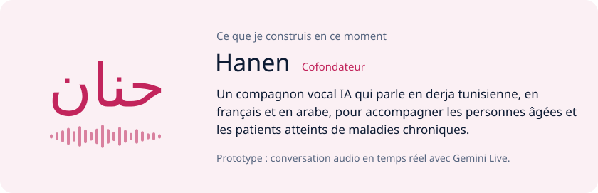
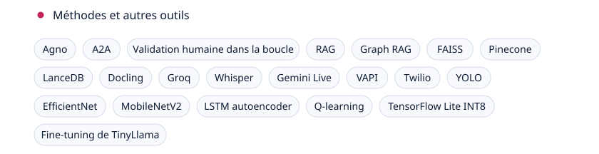

<picture><source media="(prefers-color-scheme: dark)" srcset="./assets/banner-dark.svg"></picture>

  <a href="https://www.linkedin.com/in/selim-manai"><picture><source media="(prefers-color-scheme: dark)" srcset="./assets/btn-linkedin-dark.svg"></picture></a>
  <a href="https://selim-manai.vercel.app"><picture><source media="(prefers-color-scheme: dark)" srcset="./assets/btn-portfolio-dark.svg"></picture></a>

- 🎓 **Cette année** : semestre d’échange à l’ESIGELEC, à Rouen, avec des cours de blockchain et de SAP BI.
- 🧭 **J’apprends** : à déployer mes agents dans le cloud, de bout en bout.
- 💬 **Parlez-moi de** : LangGraph, RAG et Graph RAG, MCP, agents vocaux en derja.
- 📫 **Je cherche** : un PFE de 6 mois en France, à partir du 1er mars 2027.

 

<picture><source media="(prefers-color-scheme: dark)" srcset="./assets/palmares-dark.svg"></picture>

  

<picture><source media="(prefers-color-scheme: dark)" srcset="./assets/hanen-dark.svg"></picture>

  

<picture><source media="(prefers-color-scheme: dark)" srcset="./assets/stack-dark.svg"></picture>

<picture><source media="(prefers-color-scheme: dark)" srcset="./assets/layer-0-dark.svg"></picture>&nbsp;&nbsp;&nbsp;<picture><source media="(prefers-color-scheme: dark)" srcset="https://cdn.simpleicons.org/langgraph/7FC8FF"></picture>&nbsp;&nbsp;<picture><source media="(prefers-color-scheme: dark)" srcset="https://cdn.simpleicons.org/langchain/7FC8FF"></picture>&nbsp;&nbsp;<picture><source media="(prefers-color-scheme: dark)" srcset="https://cdn.simpleicons.org/crewai/FF5A50"></picture>&nbsp;&nbsp;<picture><source media="(prefers-color-scheme: dark)" srcset="https://cdn.simpleicons.org/modelcontextprotocol/74777C"></picture>

<picture><source media="(prefers-color-scheme: dark)" srcset="./assets/layer-1-dark.svg"></picture>&nbsp;&nbsp;&nbsp;<picture><source media="(prefers-color-scheme: dark)" srcset="https://cdn.simpleicons.org/mistralai/FA520F"></picture>&nbsp;&nbsp;<picture><source media="(prefers-color-scheme: dark)" srcset="https://cdn.simpleicons.org/meta/0467DF"></picture>&nbsp;&nbsp;<picture><source media="(prefers-color-scheme: dark)" srcset="https://cdn.simpleicons.org/googlegemini/8E75B2"></picture>&nbsp;&nbsp;<picture><source media="(prefers-color-scheme: dark)" srcset="https://cdn.simpleicons.org/ollama/74777C"></picture>&nbsp;&nbsp;<picture><source media="(prefers-color-scheme: dark)" srcset="https://cdn.simpleicons.org/huggingface/FFD21E"></picture>&nbsp;&nbsp;<picture><source media="(prefers-color-scheme: dark)" srcset="https://cdn.simpleicons.org/neo4j/4581C3"></picture>

<picture><source media="(prefers-color-scheme: dark)" srcset="./assets/layer-2-dark.svg"></picture>&nbsp;&nbsp;&nbsp;<picture><source media="(prefers-color-scheme: dark)" srcset="https://cdn.simpleicons.org/tensorflow/FF6F00"></picture>&nbsp;&nbsp;<picture><source media="(prefers-color-scheme: dark)" srcset="https://cdn.simpleicons.org/onnx/005CED"></picture>&nbsp;&nbsp;<picture><source media="(prefers-color-scheme: dark)" srcset="https://cdn.simpleicons.org/apachespark/E25A1C"></picture>&nbsp;&nbsp;<picture><source media="(prefers-color-scheme: dark)" srcset="https://cdn.simpleicons.org/googlecolab/F9AB00"></picture>

<picture><source media="(prefers-color-scheme: dark)" srcset="./assets/layer-3-dark.svg"></picture>&nbsp;&nbsp;&nbsp;<picture><source media="(prefers-color-scheme: dark)" srcset="https://cdn.simpleicons.org/python/3776AB"></picture>&nbsp;&nbsp;<picture><source media="(prefers-color-scheme: dark)" srcset="https://cdn.simpleicons.org/fastapi/009688"></picture>&nbsp;&nbsp;<picture><source media="(prefers-color-scheme: dark)" srcset="https://cdn.simpleicons.org/react/61DAFB"></picture>&nbsp;&nbsp;<picture><source media="(prefers-color-scheme: dark)" srcset="https://cdn.simpleicons.org/typescript/3178C6"></picture>&nbsp;&nbsp;<picture><source media="(prefers-color-scheme: dark)" srcset="https://cdn.simpleicons.org/docker/2496ED"></picture>&nbsp;&nbsp;<picture><source media="(prefers-color-scheme: dark)" srcset="https://cdn.simpleicons.org/jenkins/D24939"></picture>&nbsp;&nbsp;<picture><source media="(prefers-color-scheme: dark)" srcset="https://cdn.simpleicons.org/postgresql/4169E1"></picture>&nbsp;&nbsp;<picture><source media="(prefers-color-scheme: dark)" srcset="https://cdn.simpleicons.org/sqlite/467188"></picture>&nbsp;&nbsp;<picture><source media="(prefers-color-scheme: dark)" srcset="https://cdn.simpleicons.org/vercel/74777C"></picture>

<picture><source media="(prefers-color-scheme: dark)" srcset="./assets/methods-dark.svg"></picture>

 

<picture><source media="(prefers-color-scheme: dark)" srcset="./assets/activite-dark.svg"></picture>

<picture><source media="(prefers-color-scheme: dark)" srcset="https://raw.githubusercontent.com/slimgithub04/slimgithub04/output/snake-dark.svg"></picture>

  

<picture><source media="(prefers-color-scheme: dark)" srcset="./assets/footer-dark.svg"></picture>

  <a href="https://www.linkedin.com/in/selim-manai"><picture><source media="(prefers-color-scheme: dark)" srcset="./assets/btn-linkedin-dark.svg"></picture></a>
  <a href="https://selim-manai.vercel.app"><picture><source media="(prefers-color-scheme: dark)" srcset="./assets/btn-portfolio-dark.svg"></picture></a>

